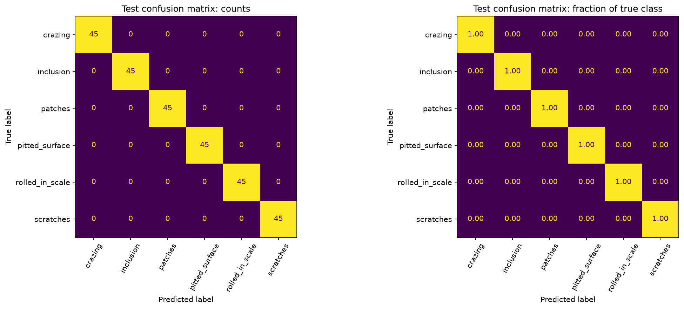
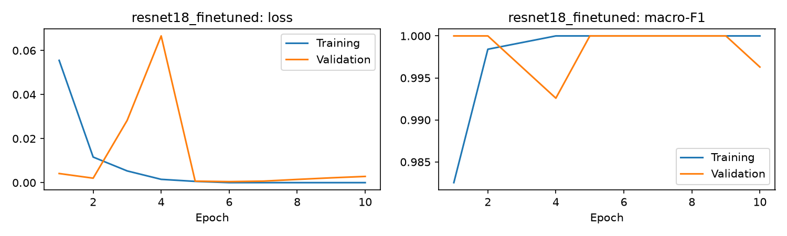

# Steel Surface Defect Classification

Six-class steel surface classification with PyTorch, comparing a CNN trained from scratch with frozen and fine-tuned ImageNet ResNet18 models. The workflow covers data inspection, duplicate removal, fixed splits, CUDA training, held-out evaluation, and Grad-CAM.

## Results

Run: `neu_cls_seed42_v1`, seed 42. Model selection used validation macro-F1, with validation loss breaking ties.

| Model | Best epoch | Completed epochs | Validation accuracy | Validation macro-F1 | Training time |
| --- | ---: | ---: | ---: | ---: | ---: |
| CNN from scratch | 21 | 25 | 92.59% | 0.9257 | 3.17 min |
| ResNet18, frozen backbone | 8 | 8 | 98.89% | 0.9889 | 0.98 min |
| ResNet18, fine-tuned last block | 6 | 10 | 100.00% | 1.0000 | 1.25 min |

The selected fine-tuned ResNet18 classified **270/270 held-out test images correctly**:

| Test metric | Value |
| --- | ---: |
| Accuracy | 100.00% |
| Macro-F1 | 1.0000 |
| Macro precision | 1.0000 |
| Macro recall | 1.0000 |
| Cross-entropy loss | 0.00247 |

Each test class contains 45 images. Only the validation winner was evaluated on test; the comparison above contains validation results. This small image-level benchmark does not establish performance on unseen factories, cameras, or physical steel samples.



Transfer learning improved validation macro-F1 from 0.9257 to 0.9889 before fine-tuning. Training all three stages took **323.9 seconds (5 min 24 sec)** on an RTX 5070 Laptop GPU with 8 GiB VRAM. This excludes environment setup, downloads, image inspection, and final reporting. The final notebook verification reused completed checkpoints; per-stage training times come from the original training histories.

## Dataset and split

[NEU-CLS](https://faculty.neu.edu.cn/songkc/en/zdylm/263265/list/) contains 1,800 grayscale 200 x 200 images across crazing, inclusion, patches, pitted surface, rolled-in scale, and scratches. There are no healthy images.

Decoded-pixel SHA-256 identified one duplicate pair (`Pa_101.bmp`, `Pa_105.bmp`). Removing one redundant copy left **1,799 images**, split before augmentation:

| Partition | Images |
| --- | ---: |
| Training | 1,259 |
| Validation | 270 |
| Test | 270 |

The saved split is stratified by class, with seed 42. Relative paths and exact pixel hashes are disjoint across partitions. Physical-source metadata was unavailable, so this is an image-level split. Near-duplicates, neighboring crops, and shared steel-strip origins remain possible. An optional complete `data/source_groups.csv` mapping enables source-group-aware splitting for a new experiment.

The [split manifest](reports/splits.csv), [duplicate report](reports/exact_duplicate_images.csv), and [data fingerprint](reports/split_metadata.json) document membership and data identity. Original images and archives are excluded from Git; download them from the dataset authors.

## Method

- Convert grayscale images to three identical channels; resize the full image to 224 x 224 and apply ImageNet normalization.
- Apply horizontal/vertical flips and mild brightness/contrast augmentation to training images only. Validation and test transformations are deterministic.
- Train a three-block CNN with 94,022 trainable parameters as the baseline.
- Replace ResNet18's classification head, train the new head with the backbone frozen, then fine-tune `layer4` and the head. BatchNorm running statistics remain fixed.
- Use AdamW, cross-entropy, CUDA mixed precision, gradient scaling, gradient clipping, and early stopping. Keep the checkpoint with the highest validation macro-F1, then lowest validation loss.
- Compare validation checkpoints, freeze the selection, and report test metrics, per-class scores, confusion matrices, predictions, and explanations.

The experiment uses batch size 32, zero loader workers for Windows notebooks, four CPU threads, and a fixed seed. The CNN/head learning rate is 0.001; fine-tuning uses 0.0001 for `layer4` and 0.0005 for the head. Maximum epochs/patience are 25/6, 8/3, and 12/4. Fine-tuning stopped after epoch 10 and retained epoch 6.



## Reproduce

Tested with Python 3.12.10, PyTorch 2.11.0+cu128, Torchvision 0.26.0+cu128, CUDA runtime 12.8, and an NVIDIA RTX 5070 Laptop GPU. Exact direct dependency versions are in `requirements-locked.txt`; the recorded environment is in [reports/environment.json](reports/environment.json).

From the cloned repository in PowerShell:

```powershell
py -3.12 -m venv .venv
& '.venv/Scripts/python.exe' -m pip install -r requirements-locked.txt
& '.venv/Scripts/python.exe' -m ipykernel install --user --name industrial-defects-rtx5070 --display-name "Python (RTX 5070 CUDA)"
New-Item -ItemType Directory -Force 'data/raw' | Out-Null
```

Download and extract the image-only **NEU-CLS** archive from the official page into `data/raw/`. For the published split, the layout is `data/raw/NEU-CLS/Cr_1.bmp`, `data/raw/NEU-CLS/In_1.bmp`, and so on. The notebook supports nested class folders too, but changed relative paths produce a different data fingerprint and may produce a different split.

Open [steel_surface_defect_classification.ipynb](steel_surface_defect_classification.ipynb) in Jupyter or VS Code, choose **Python (RTX 5070 CUDA)**, and run the numbered sections in order. To install a browser interface if needed:

```powershell
& '.venv/Scripts/python.exe' -m pip install jupyterlab
& '.venv/Scripts/python.exe' -m jupyterlab
```

The notebook checks for the RTX 5070 and moves the model and batches to CUDA. It stops if that GPU is unavailable. Other CUDA GPUs require adjusting the notebook's GPU-name selector. CPU image loading and transforms still run on the CPU.

`RUN_TRAINING` and `RUN_FINAL_TEST` are enabled. Compatible checkpoints in `outputs/neu_cls_seed42_v1/` are reused. Choose a new `RUN_NAME` for changed data/settings or a fresh training run. A first run may download ImageNet weights. Training time varies with laptop power mode, thermals, background processes, and storage.

The same notebook can be executed without a browser:

```powershell
& '.venv/Scripts/python.exe' run_notebook.py
```

## Predict a new image

The [v1.0.0 release](https://github.com/marouane5/steel-surface-defect-classification/releases/tag/v1.0.0) provides the three trained checkpoints. Download `resnet18_finetuned.pt` for the selected model; checkpoint files are stored as release assets rather than in Git history.

```powershell
& '.venv/Scripts/python.exe' predict.py 'path/to/steel_image.bmp' --checkpoint 'resnet18_finetuned.pt'
```

`predict_defect(image_path, checkpoint_path)` returns `predicted_class`, `confidence`, and `class_probabilities`. The standalone script loads the architecture, label order, and preprocessing from checkpoint metadata, requires CUDA, and does not need the training dataset. Softmax confidence is uncalibrated.

## Explanations and limitations

[Grad-CAM examples](reports/gradcam_examples.png) cover one correctly classified test image per defect class. In the displayed patch and scratch examples, high-response regions overlap visible surface marks; the maps for other texture classes are broader. These are coarse class explanations rather than verified defect boundaries. There were no test mistakes to visualize in this run.

- The model always predicts one of six defect classes. It cannot classify a healthy surface or reliably reject unrelated images.
- Exact duplicate removal does not establish independence between physical samples. Source-separated evaluation and near-duplicate analysis are needed before stronger generalization claims.
- One split and a small test set do not characterize run-to-run uncertainty or production performance. No multi-seed study or external dataset evaluation was performed.
- Augmentation assumes defect type is preserved under flips and mild illumination changes; production acquisition conditions need separate validation.
- Errors were absent on this test split, so observed failure modes cannot be inferred from its confusion matrix. A harder external test set would be the next evaluation milestone.

## Files

| File/folder | Purpose |
| --- | --- |
| `steel_surface_defect_classification.ipynb` | Executed experiment, figures, and recorded outputs |
| `predict.py` | Standalone CUDA image prediction |
| `run_notebook.py` | Notebook execution through the registered kernel |
| `requirements*.txt` | Flexible, CUDA, and recorded dependency specifications |
| `reports/` | Split manifests, histories, metrics, predictions, figures, and environment |
| `data/raw/` | Locally downloaded images; excluded from Git |
| `outputs/` | Locally generated checkpoints and run artifacts; excluded from Git |

The saved reports are a snapshot of the published experiment. Rerunning the notebook writes new artifacts to `outputs/<RUN_NAME>/`.

## References

- [NEU surface defect database and download](https://faculty.neu.edu.cn/songkc/en/zdylm/263265/list/). K. Song and Y. Yan, "A noise robust method based on completed local binary patterns for hot-rolled steel strip surface defects," *Applied Surface Science*, 285, 858-864, 2013.
- [PyTorch transfer learning tutorial](https://docs.pytorch.org/tutorials/beginner/transfer_learning_tutorial.html).
- [Torchvision ResNet18](https://docs.pytorch.org/vision/stable/models/generated/torchvision.models.resnet18.html).
- [Grad-CAM paper](https://arxiv.org/abs/1610.02391).
